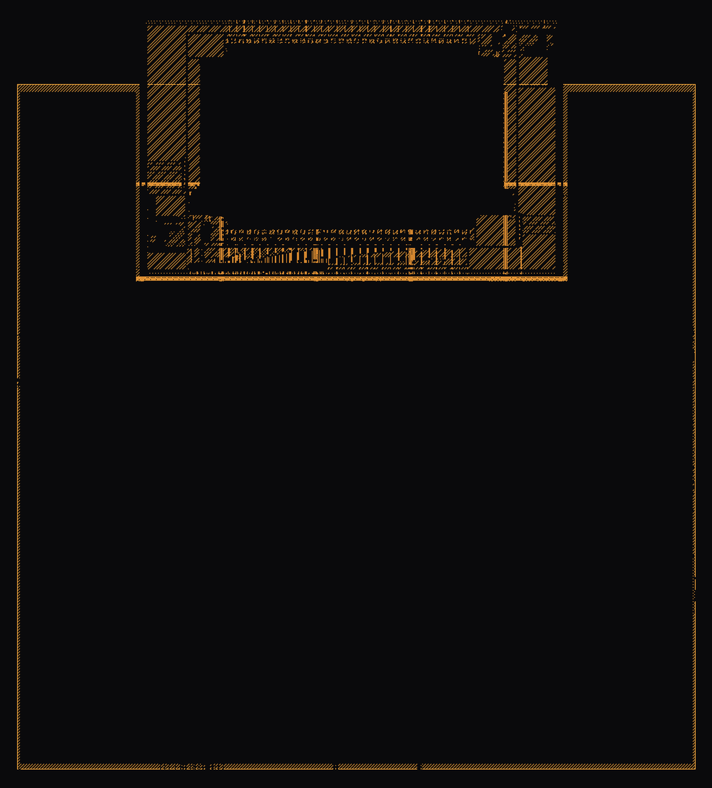

# PRJ-001 — ARGUS Environmental Sensor-Hub SoC

**I designed the agentic ASIC framework. The framework autonomously produced this layout — no human wrote RTL, testbenches, or ran EDA tools.**



> **Status: not tapeout-ready.** The flow produced a routed GDS on SkyWater 130 nm with setup and hold closed at 25 MHz. Magic DRC and LVS are not clean, and nothing was proved by formal. This page was corrected on 2026-11-07 against the evidence in this repository. See [Known gaps](#known-gaps).

---

## Chip Summary

| Metric | Value |
|--------|-------|
| **Core** | Custom five-stage RV32I pipeline, in a module named `ibex_core`. It is not lowRISC Ibex |
| **Process** | sky130_fd_sc_hd (SkyWater 130nm) |
| **Frequency** | 25 MHz (40 ns period), closed with +4.264 ns setup slack. The 50 MHz target was not reached |
| **Clock Domains** | 2 in the spec (clk_sys, clk_wb via CDC) |
| **Internal Bus** | APB v2.0, single-cycle |
| **External Bus** | Wishbone B4 pipelined → Caravel mgmt SoC |
| **SRAM** | 4 KB in the spec. The layout places one 2 KB OpenRAM macro (`sky130_sram_2kbyte_1rw1r_32x512_8`) |
| **Cells** | 32,838 standard cells and 1 macro. 231,540 instances with fill |
| **Die Area** | 1.22 mm² |
| **Power** | 1.8V core / 3.3V IO |
| **Flow** | LibreLane v3 (Yosys + OpenROAD + Magic + Klayout) |

---

## Peripherals

| # | Module | Type | Interface | Function |
|---|--------|------|-----------|----------|
| 1 | EF_UART | REUSE | APB | UART TX/RX, 115200 bps, 8N1, 8-byte FIFO |
| 2 | EF_SPI | REUSE | APB | SPI master, Mode 0/3 |
| 3 | EF_I2C | REUSE | APB | I2C master, 100/400 kHz, 7-bit addressing |
| 4 | EF_GPIO8 | REUSE | APB | 8-bit GPIO, per-pin direction/IRQ/edge-detect |
| 5 | EF_TMR32 | REUSE | APB | 2-channel PWM (10-bit, 1-25 kHz) + watchdog |
| 6 | interrupt_ctrl | CREATE | APB | 13-source priority encoder → 1 CPU IRQ |
| 7 | sys_ctrl | CREATE | APB | Chip ID, clock divider, reset cause, sleep |
| 8 | wb_bridge | CREATE | APB↔WB | APB↔Wishbone B4 async FIFO CDC bridge |
| 9 | sram_4kb | REUSE | APB | 4 KB address space, one 2 KB OpenRAM macro placed |

---

## Stage Status

These are the verdicts the flow gave itself. [Known gaps](#known-gaps) lists what they missed or waived.

| # | Stage | Verdict | Retries |
|---|-------|---------|---------|
| 0 | Business Analysis | PASS | 0 |
| 1 | Specification | PASS | 0 |
| 2 | Architecture | PASS | 0 |
| 3 | Frontend (RTL) | PASS | 2 |
| 4 | Firmware | PASS | 0 |
| 5 | Verification | PASS: no gate-level simulation | 1 |
| 6 | Promotion | PASS | 0 |
| 7 | Backend (P&R) | CONDITIONAL PASS | 8 |
| 8 | Caravel Integration | CONDITIONAL PASS: 8 of 14 precheck checks could be evaluated | 0 |
| 9 | Documentation | PASS | 0 |

### Backend Results
- **Die Area:** 1.22 mm² (1,219,300 µm²)
- **Standard Cells:** 32,838 placed, plus 1 macro and 198,701 fill cells
- **Setup WNS:** +4.264 ns at 25 MHz (40 ns period)
- **Hold WNS:** +0.107 ns
- **DRC:** route 0, Klayout 12, Magic 4,764,805, the Magic violations concentrated near the SRAM's abstract view. Not clean
- **LVS:** 66 errors, attributed to the SRAM black-box pins. Not clean
- **Max slew / cap:** 2,023 / 17 violations at the slow corner
- **STA:** Multi-corner analysis complete
- **GDS:** Final GDS delivered (run v0-run9)

### Verification
- **Testbenches:** 12 cocotb modules, 177 tests, all passing. Some compare real values, and some only check that a read did not return 0xFFFFFFFF
- **Formal:** all 12 SymbiYosys runs report `tests=0`, so nothing was proved
- **Gate-level simulation:** not run

---

## Known Gaps

1. **Timing closed at half the target.** `08_backend_stage/librelane/config.yaml` sets a 40 ns period. `00_validation_report/08_backend_validation.md` records 25 MHz.
2. **DRC and LVS are not clean.** The backend validation report flags 4,764,805 Magic DRC violations as unaddressed, and waives 66 LVS errors and 12 Klayout errors until tapeout.
3. **The SRAM is half the size in the spec.** `08_backend_stage/rtl/sram_blackbox.v` describes a 1024 × 32 interface, and states that the 2 KB macro is what gets placed.
4. **The CPU is not Ibex.** `04_frontend_stage/rtl-ibex_core/rtl/` holds small Verilog files with a five-stage pipeline, not lowRISC's source.
5. **Formal and gate-level checks did not happen.** See Verification above.

---

## Repository Structure

```
├── README.md
├── layout_beauty.png          ← Dark-background GDS render (1600px)
├── LICENSE
├── THIRD_PARTY.md
├── waiver_ledger.json
├── .gitignore
├── templates                  ← Project templates
├── 00_validation_report/      ← Per-stage validation reports
├── 11_postmortem_audit/       ← Stage-by-stage lessons learned
├── 01_business_stage/         ← Market analysis + feasibility
├── 02_specification_stage/    ← System spec (525 lines SRS)
├── 03_architecture_stage/     ← Architecture doc (1183 lines)
├── 04_frontend_stage/         ← RTL + lint/synth/formal/equiv logs
├── 05_firmware_stage/         ← BSP + drivers + bootrom
├── 06_verification_stage/     ← Cocotb testbenches + results
├── 07_promote_stage/          ← Per-module promotion reports
├── 08_backend_stage/          ← GDS + constraints + macros
├── 09_caravel_stage/          ← Caravel wrapper + precheck
└── 10_document_stage/         ← Project documentation
```

---

## Third-Party Components

| Component | Source | License |
|-----------|--------|---------|
| OpenRAM 2 KB SRAM macro | OpenRAM Project | BSD 3-Clause |
| EF_UART, EF_SPI, EF_I2C, EF_GPIO8, EF_TMR32 | Efabless IP Library | Apache 2.0 |
| Caravel Harness | Efabless | Apache 2.0 |
| sky130 PDK | SkyWater / Google | Apache 2.0 |

The CPU core is original to this project, not lowRISC Ibex. See [THIRD_PARTY.md](THIRD_PARTY.md) for full attribution.

---

## Waivers

[waiver_ledger.json](waiver_ledger.json) holds one legacy entry. The waivers that matter are in `00_validation_report/08_backend_validation.md`.

---

## License

Apache 2.0. See [LICENSE](LICENSE).

---

*Built with Vera (Hermes Agentic ASIC Framework) — PRJ-001 v0, July 2026. README corrected November 2026.*
*No human wrote RTL, testbenches, constraints, or ran EDA tools for this layout.*
